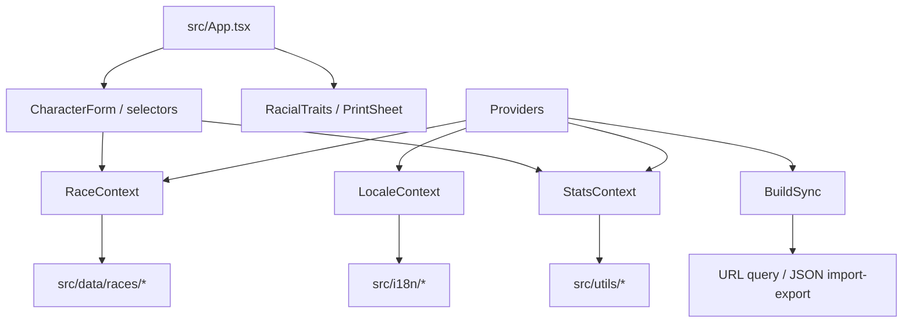

# Architecture

Vite + React SPA with static SEO assets and client-side character state. Race rules live in TypeScript data modules. Pure utilities compute costs, modifiers, and choices.

## High-level flow

## Major pieces

| Area | Path | Role |
| --- | --- | --- |
| App shell | `src/main.tsx`, `src/App.tsx`, `src/Providers.tsx` | Bootstrap, layout chrome, providers |
| UI | `src/components/` | Form, attribute table, race/options selectors, print sheet, language select |
| State | `src/context/` | Locale, rules edition, origin and race choices, ability scores and budget |
| Origin rules | `src/data/origins2024.ts`, `src/data/races/` | 2024 species and backgrounds, 2014 race bonuses and grants |
| Lookups | `src/data/` | Skills, languages, tools, feats, dragons, cantrips |
| Calculations | `src/utils/` | Point cost, modifiers, racial bonuses, build serialize/parse |
| i18n | `src/i18n/` | Locales, UI strings, display names, Chinese racial trait text |
| Types | `src/types/` | Race / attribute contracts |
| SEO | `index.html`, `public/` | Default meta tags, robots, sitemap, manifest, Open Graph image |

## Control and data flow

1. `main.tsx` reads `?lang=` from the URL for the initial locale, document language, and JSON-LD. `BuildSync` restores build state from the URL and updates the query in browser history as the user edits.
2. `RaceContext` defaults to 2024 and stores each edition’s selections separately when switching rules. `StatsContext` holds the base scores and budget shared between editions.
3. The 2024 build links use `rules=2024`, and 2024 JSON exports use version 2. Build links without an edition marker and version 1 JSON files restore the 2014 rules. Calculations apply the active edition’s bonuses to the shared base scores.
4. Locale changes swap UI copy and labels via `LocaleContext` / `src/i18n`; race rules text falls back to English when a locale has no trait translation (Chinese has dedicated trait text).

## Where a typical change lands

| Change | Touch |
| --- | --- |
| New race or variant | `src/data/races/`, dropdown/registry, i18n names (and Chinese traits if supporting `zh`) |
| Point-buy or modifier math | `src/utils/`, matching `*.test.ts` |
| New UI control | `src/components/`, wire through contexts |
| New locale | `src/i18n/locale.ts`, `messages.ts`, `names.ts`, language select; trait text if needed |
| Shareable build field | `src/utils/characterBuild.ts` and `BuildSync` |

## Boundaries

Assumption from the README: this remains a **browser calculator**, not a server API. There is no documented database or auth layer; do not introduce them without an explicit roadmap item.
